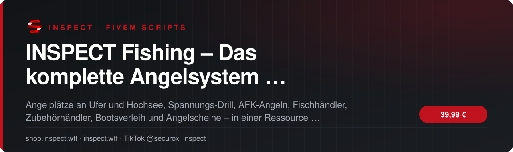
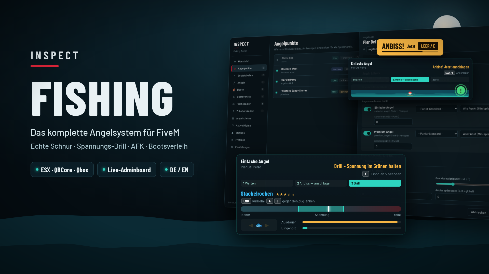
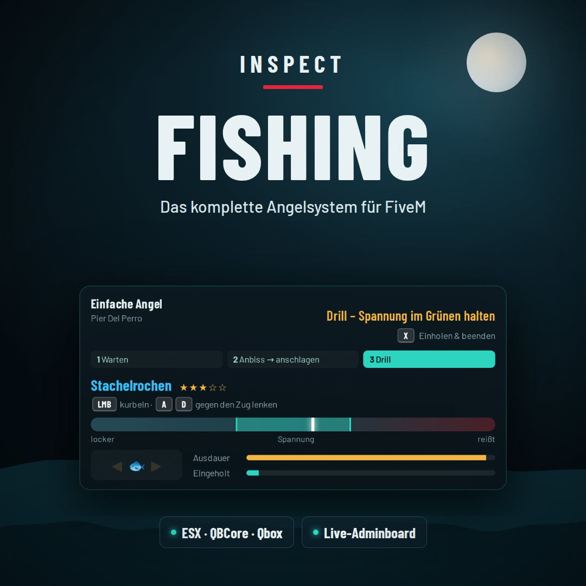
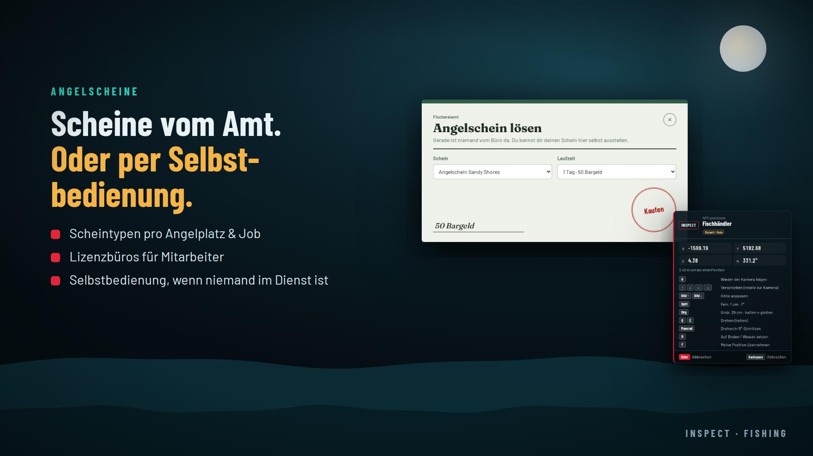
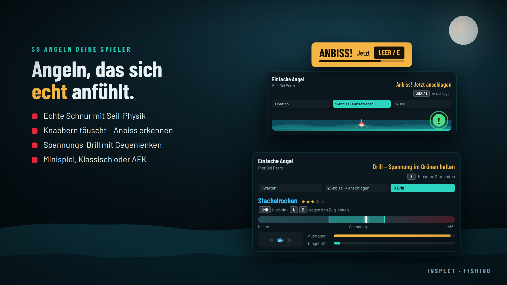
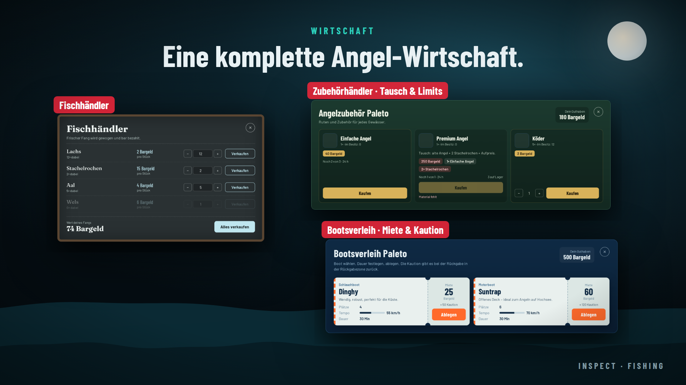
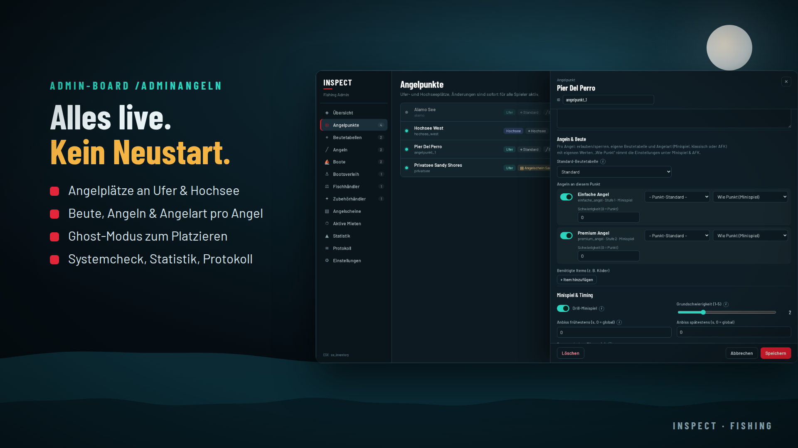

<!-- inspect-showcase: automatisch erzeugt, Änderungen bitte im Shop vornehmen -->

  
  
  
  

<h3>Angelplätze an Ufer und Hochsee, Spannungs-Drill, AFK-Angeln, Fischhändler, Zubehörhändler, Bootsverleih und Angelscheine – in einer Ressource. Echte Angelschnur, alles live im Spiel verwaltbar und automatische Erkennung von ESX Legacy, QBCore und Qbox.</h3>

  
  
  
  

---

## Überblick

Ein Angelsystem, das sich wie ein eigenes Hobby anfühlt.

Die meisten Angel-Scripts sind ein Tastendruck, ein Fortschrittsbalken und ein Item. INSPECT Fishing macht daraus ein echtes Erlebnis: Die Schnur hängt mit Seil-Physik von der Rutenspitze zur Pose, die auf dem Wasser treibt. Knabbern täuscht, der echte Anbiss will rechtzeitig angeschlagen werden, und im Spannungs-Drill hält der Spieler die Nadel im grünen Bereich, während der Fisch zur Seite zieht. Nach dem Fang hängt der Fisch an der Schnur vor dem Spieler.

Alles live im Spiel verwalten
Über das Admin-Board /adminangeln legt ihr Angelplätze, Beutetabellen, Angeln, Händler, Boote, Verleihstationen und Angelscheine direkt im Spiel an. Positionen und NPCs setzt ihr per Ghost-Vorschau zentimetergenau. Jede Änderung ist sofort für alle Spieler aktiv – ohne Neustart der Ressource.

Für jeden Spielstil
Pro Angelplatz – und sogar pro Angel an einem Platz – wählt ihr zwischen Drill-Minispiel, klassischem Angeln oder AFK-Angeln. Beim AFK-Angeln läuft alles automatisch, mit einstellbarer Fangchance und langsamerem Anbiss, damit aktives Angeln sich weiterhin lohnt. Hochsee-Plätze haben eigene Blips und Radius-Flächen und sind nur vom Deck eines Bootes aus erreichbar.

Eine komplette Angel-Wirtschaft
Fischhändler kaufen den Fang zu euren Preisen. Zubehörhändler verkaufen oder tauschen Ausrüstung mit Limits pro Spieler und gemeinsamem Lager. Der Bootsverleih arbeitet mit Miete, Kaution und fortlaufenden Kennzeichen. Angelscheine werden von Job-Mitarbeitern im Lizenzbüro ausgestellt – und wenn niemand im Dienst ist, kaufen Spieler ihren Schein per Selbstbedienung.

Serverseitig abgesichert
Anbiss, Beute und Fang werden auf dem Server ausgewürfelt und geprüft: Session-Token, Mindestzeiten, Distanz, Schein, Items und Platz im Inventar. Verdächtige Fang-Meldungen landen im Protokoll und auf Wunsch in Discord.

Schnell installiert
Framework und Inventar werden automatisch erkannt, alle Tabellen legt das Script beim ersten Start selbst an. Ausgeliefert wird ein sauberes, leeres System mit zwei Beispiel-Angeln und einem Boots-Katalog, damit ihr alles genau für euren Server einrichtet. Eine bebilderte Installations- und Einrichtungsanleitung (PDF) führt Schritt für Schritt durch.

## Funktionen

- ✅ Kompatibilität · ESX Legacy, QBCore und Qbox mit automatischer Framework-Erkennung
- ✅ Kompatibilität · Inventare: ox_inventory, jaksam_inventory, qs-inventory, qb-inventory, ps-inventory, lj-inventory und Framework-Standard – automatisch erkannt
- ✅ Kompatibilität · Datenbank über oxmysql, Tabellen werden beim ersten Start automatisch angelegt
- ✅ Angeln · Echte Angelschnur mit Seil-Physik von der Rutenspitze zur schwimmenden Pose
- ✅ Angeln · Knabbern als Täuschung, deutlicher Anbiss-Hinweis und Wasser-Effekte
- ✅ Angeln · Spannungs-Drill: Kurbeln, Spannung im grünen Bereich halten, gegen den Zug lenken
- ✅ Angeln · Gefangener Fisch hängt nach dem Fang an der Schnur vor dem Spieler
- ✅ Angeln · Drill-Minispiel, klassisches Angeln oder AFK-Angeln – pro Angelplatz und pro Angel wählbar
- ✅ Angeln · AFK-Angeln mit einstellbarer Fangchance und Anbisszeit, HUD bleibt sichtbar
- ✅ Angeln · Thematisches HUD mit Wasserlinie, Pose, Schritt-Anzeige und Anbiss-Fortschritt
- ✅ Angelplätze · Ufer- und Hochsee-Plätze mit eigenen Blips, Radius-Flächen und Markern
- ✅ Angelplätze · Pro Angel erlauben oder sperren, eigene Beutetabelle und eigene Angelart
- ✅ Angelplätze · Angelschein-Pflicht, Job-Freigaben mit Rängen, nur vom Boot aus, benötigte Items wie Köder
- ✅ Beute · Beutetabellen mit Gewichtung, Seltenheit, Gewichtsspanne und Schwierigkeit
- ✅ Angeln · Beliebig viele Ruten mit Stufe, Anbisszeit, Kurbeltempo, Schnurstärke, Seltenheitsbonus und Wurfweite
- ✅ Angeln · Verschleiß mit Bruchgefahr ab Fang X und sicherem Bruch nach N Fängen
- ✅ Fischhändler · Eigene Preislisten, Währung pro Händler (Konto oder Item), optional nur für bestimmte Jobs sichtbar
- ✅ Zubehörhändler · Verkauf und Tausch gegen Geld und/oder Material
- ✅ Zubehörhändler · Limits pro Spieler und Zeitraum, gemeinsames Lager mit automatischem Auffüllen
- ✅ Bootsverleih · Miete und Kaution, mehrere Spawnpunkte, Rückgabezone, fortlaufende Kennzeichen (FISCH001 …)
- ✅ Bootsverleih · Boots-Katalog mit Farben, Tuning, Extras und Tank, Kaution anteilig nach Schaden
- ✅ Bootsverleih · Aktive Mieten live einsehen, verlängern oder beenden
- ✅ Angelscheine · Vergeben, verlängern und löschen – online oder per Identifier
- ✅ Angelscheine · Lizenzbüros für Job-Mitarbeiter mit automatischer oder manueller Selbstbedienung
- ✅ Admin-Board · /adminangeln: alle Bereiche live verwalten – ohne Ressourcen-Neustart
- ✅ Admin-Board · Ghost-Modus zum zentimetergenauen Platzieren von Punkten, NPCs, Spawns und Rückgabezonen
- ✅ Admin-Board · Item-Auswahl mit Live-Vorschau, Job-Auswahl mit Rängen, Systemcheck und Statistik
- ✅ Admin-Board · Hilfe-Symbole an den wichtigen Feldern und Tooltips an allen Symbolen
- ✅ Sicherheit · Anbiss, Beute und Fang werden serverseitig ausgewürfelt und geprüft
- ✅ Sicherheit · Session-Token, Mindestzeiten, Distanzprüfung und Rate-Limits gegen Missbrauch
- ✅ Protokoll · Eigener Discord-Webhook pro Bereich, jeweils mit Test-Knopf
- ✅ Sprache · Deutsch und Englisch, live im Admin-Board umschaltbar
- ✅ Integrationen · Fahrzeugschlüssel (qb-vehiclekeys, qbx_vehiclekeys, wasabi_carlock, MrNewbVehicleKeys) und Tank (ox_fuel, LegacyFuel, cdn-fuel, ps-fuel), eigene Systeme einfach ergänzbar
- ✅ Entwickler · Exports für Angelscheine, Angelplätze, Mieten und Daten sowie Event bei jedem Fang
- ✅ Entwickler · Config, Bridges, Texte und Item-Vorlagen offen editierbar
- ✅ Rechte · ACE-Recht inspect.fishing.admin, zusätzliche Framework-Gruppen konfigurierbar
- ✅ Installation · Item-Vorlagen für ox_inventory, QBCore und ESX sowie SQL-Sicherung enthalten
- ✅ Installation · Bebilderte Installations- und Einrichtungsanleitung als PDF
- ✅ Voraussetzungen · OneSync und oxmysql

## Einblicke

<table>
  <tr>
    <td width="50%"></td>
    <td width="50%"></td>
  </tr>
  <tr>
    <td width="50%"></td>
    <td width="50%"></td>
  </tr>
  <tr>
    <td width="50%"></td>
    <td width="50%"></td>
  </tr>
</table>

## Video

Neue Clips, Updates und Vorschauen gibt es regelmäßig auf TikTok: **[@securox_inspect](https://www.tiktok.com/@securox_inspect)**

## Preise

| Produkt | Preis |
|:--|--:|
| INSPECT Fishing – Das komplette Angelsystem für FiveM | **39,99 €** |

<a href="https://shop.inspect.wtf/produkt/inspect-fishing"><b>➜ Zum Produkt im Shop</b></a>

## Kauf, Einrichtung & Support

1. **Kaufen** im offiziellen Shop: [shop.inspect.wtf](https://shop.inspect.wtf) – PayPal und Karte, Rechnung automatisch per E-Mail.
2. **Freischaltung & Download** findest du sofort nach der Zahlung in deinem Kundenkonto.
3. **Hilfe** bekommst du im [INSPECT Discord](https://discord.gg/inspect) – schnell, persönlich und auf Deutsch.

| | |
|:--|:--|
| 🛒 Shop | [shop.inspect.wtf](https://shop.inspect.wtf) |
| 🌐 Website | [inspect.wtf](https://inspect.wtf) |
| 💬 Discord | [discord.gg/inspect](https://discord.gg/inspect) |
| 🎬 TikTok | [@securox_inspect](https://www.tiktok.com/@securox_inspect) |
| ✉️ E-Mail | [info@inspect.wtf](mailto:info@inspect.wtf) |

---

<b>INSPECT</b> · Offizielle Produktpräsentation. Dieses Repository enthält keinen Quellcode und keine Produktdateien. 
Kauf und Lizenzen ausschließlich über <a href="https://shop.inspect.wtf">shop.inspect.wtf</a> · Inhalte werden automatisch aus dem Shop aktualisiert.

